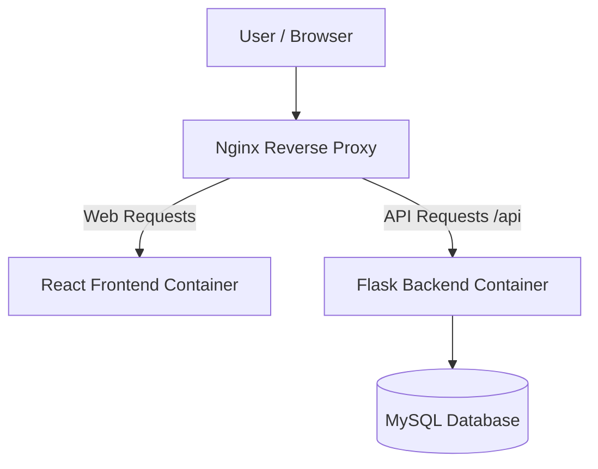

# Containerized Employee Management System

A full-stack Employee Management System built with **React, Flask, and MySQL**, containerized using Docker and orchestrated with Docker Compose.

This project demonstrates containerization, multi-service architecture, reverse proxy configuration, automated testing, and CI/CD practices using GitHub Actions.

## Overview

The Employee Management System provides a web-based dashboard for managing employee records. It supports CRUD operations, employee statistics, input validation, and dynamic search.

The application is structured as separate frontend, backend, and database services, allowing each component to run independently within a containerized environment.

## Key Features

- **Employee Management:** Create, view, update, and delete employee records.
- **Dashboard Analytics:** View employee count, department statistics, and salary metrics.
- **Search and Filtering:** Search employees by name, email, department, and job title.
- **Input Validation:** Validate employee information and prevent duplicate email addresses.
- **REST API:** Flask-based API for communication between frontend and backend.
- **Health Monitoring:** Dedicated API health endpoint for service monitoring.
- **Containerization:** Docker-based frontend and backend images.
- **Service Orchestration:** Docker Compose for managing multiple services.
- **Reverse Proxy:** Nginx routes frontend requests and API traffic.
- **Persistent Storage:** Named Docker volume for MySQL data.
- **CI/CD Automation:** GitHub Actions workflow for automated project validation and Docker image delivery.

## Technology Stack

| Category | Technologies |
|---|---|
| Frontend | React 18, Vite 5, JavaScript, CSS |
| Backend | Python 3.12, Flask 3 |
| Database | MySQL 8 |
| ORM | Flask-SQLAlchemy |
| Containerization | Docker, Docker Compose |
| Web Server | Nginx |
| CI/CD | GitHub Actions |
| Testing | Pytest |
| Security Scanning | Trivy |
| Container Registry | Docker Hub |

## Architecture

The application uses a multi-container architecture with separate services for the frontend, backend, database, and reverse proxy.



### Service Responsibilities

| Service | Responsibility |
|---|---|
| Nginx | Entry point and reverse proxy |
| Frontend | Serves the React application |
| Backend | Handles REST API requests and business logic |
| MySQL | Stores employee records |

### Docker Networking

The application uses separate Docker bridge networks:

- `frontend-network`: Enables communication between Nginx, frontend, and backend.
- `backend-network`: Enables communication between backend and MySQL.

The backend connects to MySQL using the internal Docker service name `mysql`, rather than an external IP address.

### Data Persistence

MySQL data is stored in a named Docker volume:

`mysql-data`

This allows database data to persist across container restarts and recreation.

## Project Structure

```text
Containerized-Employee-Management-System/
│
├── .github/
│   └── workflows/          # GitHub Actions workflows
│
├── backend/
│   ├── Dockerfile          # Multi-stage backend image
│   ├── app.py              # Flask application
│   ├── requirements.txt
│   ├── schema.sql
│   ├── config/
│   ├── models/
│   ├── routes/
│   └── tests/              # Pytest test suite
│
├── frontend/
│   ├── Dockerfile          # Multi-stage frontend image
│   ├── nginx.conf
│   ├── package.json
│   └── src/
│
├── nginx/
│   └── nginx.conf          # Main reverse proxy configuration
│
├── .env.example
├── docker-compose.yml
└── README.md
```

## Prerequisites

Before running the project, ensure the following tools are installed:

- Docker Desktop or Docker Engine
- Docker Compose v2
- Git

## Environment Configuration

Clone the repository:

```bash
git clone https://github.com/Gamjt19/Containerized-Employee-Management-System.git

cd Containerized-Employee-Management-System
```

Create the environment file:

```bash
cp .env.example .env
```

Configure the following variables in `.env`:

```env
DB_HOST=mysql
DB_PORT=3306
DB_NAME=employee_db
DB_USER=employee_user
DB_PASSWORD=change_this_password

MYSQL_ROOT_PASSWORD=change_this_root_password

FLASK_ENV=production
FLASK_PORT=5000

VITE_API_URL=/api
```

Use strong passwords and never commit the actual `.env` file to GitHub.

## Running the Application with Docker

### 1. Build the Frontend Image

The current Compose configuration references a prebuilt frontend image.

Build it before starting the services:

```bash
docker build \
  --build-arg VITE_API_URL=/api \
  -t employee-frontend:1.0 \
  ./frontend
```

### 2. Start the Application

Build the backend image and start all services:

```bash
docker compose up -d --build
```

### 3. Verify Running Containers

```bash
docker compose ps
```

Check application logs:

```bash
docker compose logs -f
```

Check individual services:

```bash
docker compose logs backend
docker compose logs mysql
docker compose logs nginx
```

### 4. Access the Application

Open the following URL in your browser:

**http://localhost**

The application is exposed through the Nginx reverse proxy.

### 5. Stop the Application

```bash
docker compose down
```

To remove containers and the persistent database volume:

```bash
docker compose down -v
```

**Warning:** Removing the volume permanently deletes the stored MySQL data.

## Docker Implementation

### Backend Container

The backend Dockerfile uses a multi-stage build approach:

- Python 3.12 slim base image.
- Dependencies installed in a separate build stage.
- Production dependencies copied into the runtime image.
- Non-root application user for improved security.
- Health check endpoint for container monitoring.

### Frontend Container

The frontend Dockerfile uses a multi-stage build:

- Node.js 22 Alpine for building the React application.
- Vite production build generates optimized static assets.
- Nginx Alpine serves the generated frontend files.
- Build-time environment configuration through Docker build arguments.

### Docker Compose

Docker Compose coordinates the following services:

- MySQL database
- Flask backend
- React frontend
- Nginx reverse proxy

It also configures service dependencies, health checks, bridge networks, and persistent database storage.

## CI/CD Pipeline

The project includes a GitHub Actions workflow to automate application validation and container delivery.

The pipeline covers the following stages:

1. **Lint and Test:** Runs automated validation and backend tests.
2. **Docker Build:** Builds application container images.
3. **Security Scan:** Uses Trivy to scan container images for vulnerabilities.
4. **Docker Hub Push:** Publishes container images to Docker Hub.

The workflow is maintained under:

`.github/workflows/`

Container registry credentials should be configured using GitHub Actions repository secrets rather than hardcoded credentials.

## Backend API Reference

Base API path:

`/api`

| Method | Endpoint | Description |
|---|---|---|
| GET | `/api/health` | Check backend health |
| GET | `/api/employees` | Retrieve all employees |
| GET | `/api/employees/search?q=query` | Search employees |
| GET | `/api/employees/<id>` | Retrieve an employee |
| POST | `/api/employees` | Create an employee |
| PUT | `/api/employees/<id>` | Update an employee |
| DELETE | `/api/employees/<id>` | Delete an employee |

### Health Check Example

```bash
curl http://localhost/api/health
```

### Retrieve Employees

```bash
curl http://localhost/api/employees
```

## Running Backend Tests

The backend test suite uses Pytest with an isolated in-memory SQLite database.

Navigate to the backend directory:

```bash
cd backend
```

Install dependencies:

```bash
pip install -r requirements.txt
```

Run tests:

```bash
python -m pytest tests/ -v
```

The test suite covers:

- API health checks
- Employee CRUD operations
- Input validation
- Duplicate email prevention
- Employee search
- Error handling and HTTP responses

## Security and Reliability Considerations

The project incorporates several practices commonly used in containerized environments:

- Non-root user execution in the backend container.
- Environment-based configuration for sensitive credentials.
- Docker image vulnerability scanning using Trivy.
- Health checks for service availability.
- Persistent database storage using Docker volumes.
- Isolated service communication using Docker networks.
- Separation of frontend, backend, and database responsibilities.

## Future Improvements

Potential enhancements include:

- Automated deployment to a cloud environment such as Azure.
- Container image publishing with versioned tags.
- Kubernetes deployment using AKS.
- Infrastructure provisioning using Terraform.
- Centralized monitoring using Prometheus and Grafana.
- Enhanced logging and observability.

## Author

**Gamil Jacob Thomas**

B.Tech Computer Science and Engineering | 2026 Graduate

GitHub: https://github.com/Gamjt19

Portfolio: https://gamjt.vercel.app

---

*This project was developed to explore full-stack application development and practical DevOps engineering concepts through containerization, automation, and service orchestration.*
